# Homework 3


## Блок А

### 2.1 :

1. **kubectl get ingress -A**
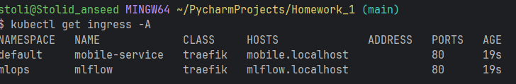
2. **kubectl get pods -A**
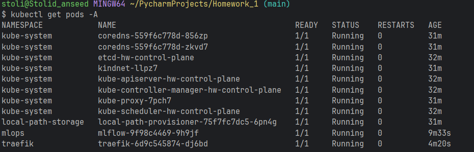
3. MlFlow
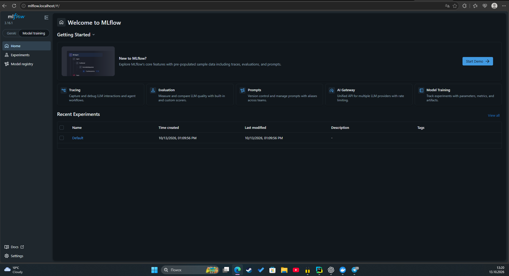

## Блок Б

### 2.2:
1. Champion
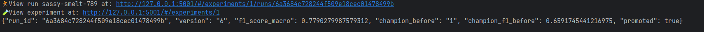
2. Challenger
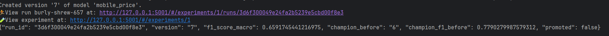
3. SOTA
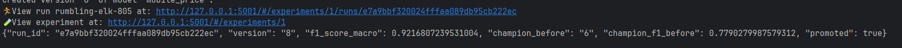
MlFlow:
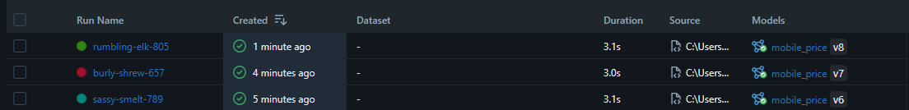
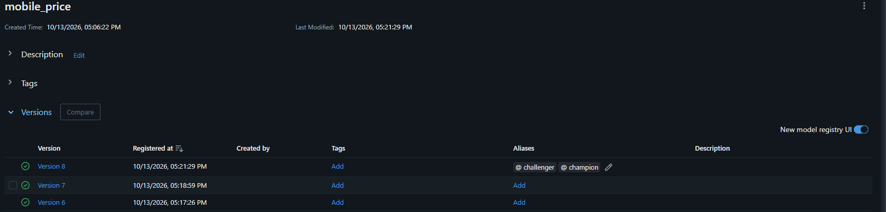

**Поставил жесткий Mini_Gain, так как для замены модели требуется значительные изменения в качестве**

### 2.3:
1. До отката:
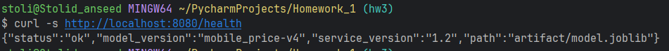
2. После отката:
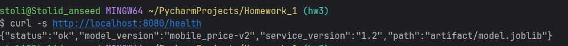

По времени заняло около 60 секунд от клика в UI, до ответа старой версии

## Блок С

### 2.4:
1. Runner in GitHub 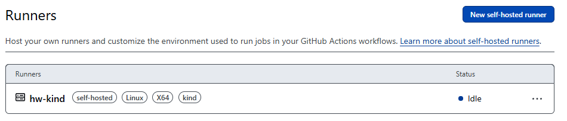
2. [ссылка на прогон](https://github.com/Stolide-anseed/Homework/actions/runs/39008442440)

### 2.5:
1. dvc push - train.csv
```
(mobile-price-service) PS C:\Users\stoli\PycharmProjects\Homework_1> uv run dvc push                              
Collecting                                                                                                                                                                            |1.00 [00:00,  383entry/s]
Pushing
1 file pushed    
```
2. dvc push - change_blue.csv
```
(mobile-price-service) PS C:\Users\stoli\PycharmProjects\Homework_1> uv run dvc push                    
Collecting                                                                                                                                                                            |2.00 [00:00,  333entry/s]
Pushing
1 file pushed   
```
3. dvc diff
```
(mobile-price-service) PS C:\Users\stoli\PycharmProjects\Homework_1> uv run dvc diff HEAD~1
Added:
    data\change_blue.csv

files summary: 1 added
```
4. dvc pull в чистом клоне
```
PS C:\Users\stoli\PycharmProjects\Homework> uv run dvc pull
Collecting                                                                                                                                                                            |2.00 [00:00,  333entry/s]
Fetching
Building workspace index                                                                                                                                                              |1.00 [00:00, 66.3entry/s]
Comparing indexes                                                                                                                                                                    |4.00 [00:00, 4.01kentry/s]
Applying changes                                                                                                                                                                      |2.00 [00:00,  71.0file/s]
A       data\change_blue.csv
A       data\train.csv
2 files fetched and 2 files added
```
5. Скрины с разными прогонами:
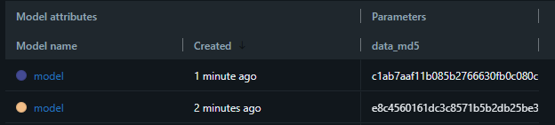

### 2.6:
1. Вывод kubectl get hpa -w (прогон 40 пользователей по +20 каждую секунду)
```
NAME             REFERENCE                   TARGETS       MINPODS   MAXPODS   REPLICAS   AGE
mobile-service   Deployment/mobile-service   cpu: 3%/60%     2         6         6          8m1s
mobile-service   Deployment/mobile-service   cpu: 3%/60%     2         6         6          12m
mobile-service   Deployment/mobile-service   cpu: 3%/60%     2         6         2          12m
mobile-service   Deployment/mobile-service   cpu: 92%/60%    2         6         2          14m
mobile-service   Deployment/mobile-service   cpu: 278%/60%   2         6         4          14m
mobile-service   Deployment/mobile-service   cpu: 331%/60%   2         6         6          15m
mobile-service   Deployment/mobile-service   cpu: 200%/60%   2         6         6          15m
mobile-service   Deployment/mobile-service   cpu: 183%/60%   2         6         6          15m
mobile-service   Deployment/mobile-service   cpu: 180%/60%   2         6         6          15m
mobile-service   Deployment/mobile-service   cpu: 154%/60%   2         6         6          16m
mobile-service   Deployment/mobile-service   cpu: 9%/60%     2         6         6          16m

```
2. kubectl --context kind-hw describe hpa
```
$ kubectl --context kind-hw describe hpa
Name:                                                  mobile-service
Namespace:                                             default
Labels:                                                <none>
Annotations:                                           <none>
CreationTimestamp:                                     Sat, 17 Oct 2026 12:07:13 +0300
Reference:                                             Deployment/mobile-service
Metrics:                                               ( current / target )
  resource cpu on pods  (as a percentage of request):  5% (5m) / 60%
Min replicas:                                          2
Max replicas:                                          6
Deployment pods:                                       6 current / 6 desired
Conditions:
  Type            Status  Reason               Message
  ----            ------  ------               -------
  AbleToScale     True    ScaleDownStabilized  recent recommendations were higher than current one, applying the highest recent recommendation
  ScalingActive   True    ValidMetricFound     the HPA was able to successfully calculate a replica count from cpu resource utilization (percentage of request)
  ScalingLimited  True    TooManyReplicas      the desired replica count is more than the maximum replica count
  ScaledToZero    False   NotScaledToZero      the HPA controller did not scale the workload to zero
Events:
  Type    Reason             Age                  From                       Message
  ----    ------             ----                 ----                       -------
  Normal  SuccessfulRescale  9m23s (x2 over 18m)  horizontal-pod-autoscaler  New size: 2; reason: All metrics below target
  Normal  SuccessfulRescale  8m23s (x3 over 26m)  horizontal-pod-autoscaler  New size: 4; reason: cpu resource utilization (percentage of request) above target
  Normal  SuccessfulRescale  8m8s (x3 over 26m)   horizontal-pod-autoscaler  New size: 6; reason: cpu resource utilization (percentage of request) above target
```

| Пользователи | Реплики | p95 | CPU        | Request CPU до и после                                |
|--------------|---------|-----|------------|-------------------------------------------------------|
| 20           | 6/6     | 16  | около 200m | до 15m, после около 200m на каждую поду (при 6 подах) |
| 40           | 6/6     | 17  | около 400m | до 15m, после около 400m на каждую поду (при 6 подах) |
| 60           | 6.6     | 21  | около 650m | до 15m, после около 650m на каждую поду (при 6 подах) |
### 2.7
1. [красный прогон Configmap](https://github.com/Stolide-anseed/Homework/actions/runs/39022519785/attempts/1), [зелённый прогон](https://github.com/Stolide-anseed/Homework/actions/runs/39023191427), упал на моменте загрузки сервера и выдал ошибку (Error from server (BadRequest): previous terminated container "api" in pod "mobile-service-77f4d6749f-6rmtn" not found), также под находиться в состояние CrashLoopBackOff, как понять, что проблема в именно в Configmap не до конца понял
2. [красный прогон](https://github.com/Stolide-anseed/Homework/actions/runs/39024384981), [зелённый прогон](https://github.com/Stolide-anseed/Homework/actions/runs/39030069998), ``Run B=~/.local/bin && mkdir -p $B && echo "$B" >> "$GITHUB_PATH"
ERROR: could not locate any control plane nodes for cluster named 'wrong_cluster'. Use the --name option to select a different cluster
Error: Process completed with exit code 1.``, как видно по логам можно увидеть, что программа не может найти кластер
3. [красный прогон Ingress](https://github.com/Stolide-anseed/Homework/actions/runs/39033396011), [Зелённый прогон](https://github.com/Stolide-anseed/Homework/actions/runs/39033837723), ``curl: (22) The requested URL returned error: 404`` логи по которым можно понять, что проблема с подключением и один из вариантов такой поломки, как раз неправильный host

### 2.8

| № | Вопросы                                                       | Ответы                                                                                                                                                                                                                                                                                                                                                                                                                                              |
|---|---------------------------------------------------------------|-----------------------------------------------------------------------------------------------------------------------------------------------------------------------------------------------------------------------------------------------------------------------------------------------------------------------------------------------------------------------------------------------------------------------------------------------------|
| 1 | Почему tests и build в облаке, а deploy — на своём runner?    | Тестам и сборке нужны только код и зависимости, в отличии от деплоя, где требуется кластер. До этого мы его создавали и удаляли, а сейчас же он существует локально на пк                                                                                                                                                                                                                                                                           |
| 2 | Зачем сеть kind, Docker socket и group-add 0?                 | Доступ к Docker socket даёт широкие права, поэтому на runner нельзя выполнять непроверенный код. --network kind позволяет runner обращаться к контейнерам узлов kind по внутренним адресам. --group-add 0 добавляет пользователя runner в группу с GID 0 — в нашей конфигурации это необходимо для доступа к сокету; без подходящих прав будет permission denied                                                                                    |
| 3 | Почему Secret создаётся через dry-run и apply?                | --dry-run=client -o yaml формирует манифест Secret, не создавая его, а kubectl apply создаёт или обновляет ресурс. Это позволяет повторять деплой: обычный kubectl create secret при втором запуске завершится ошибкой AlreadyExist                                                                                                                                                                                                                 |
| 4 | Чем challenger отличается от champion?                        | challenger - новая модель-кандидат, а champion - модель, выбранная для обслуживания запросов после прохождения гейта.                                                                                                                                                                                                                                                                                                                               |
| 5 | Что будет, если модель ещё не обучена?                        | Если задан MODEL_NAME, но зарегистрированной модели или алиаса champion нет, приложение упадёт при загрузке модели на старте                                                                                                                                                                                                                                                                                                                        |
| 6 | Как запрос доходит до MLflow?                                 | Браузер -> mlflow.localhost:80 -> Docker-проброс на узел kind:30080 -> Traefik -> правило Ingress -> Service mlflow:5000 -> Pod MLflow:5000                                                                                                                                                                                                                                                                                                         |
| 7 | Сколько реплик должен выставить HPA?                          | При 2 репликах, загрузке 92% и цели 60% получаем 2 × 92 / 60 = 4, то есть от 2 до 6                                                                                                                                                                                                                                                                                                                                                                 |
| 8 | Что хранится в Git и DVC и как восстановить данные версии N?  | В Git находятся код, .dvc-файлы с хешами и путями данных, а также настройки DVC; содержимое датасетов хранится в DVC remote, у меня — в соседней папке dvc-storage. Для версии N модели нужно открыть связанный Run в MLflow и взять параметр data_md5, затем найти коммит, где соответствующий .dvc-файл содержит этот хеш. В отдельном клоне переключиться на найденный коммит, выполнить uv run dvc pull и проверить MD5 восстановленного файла. |