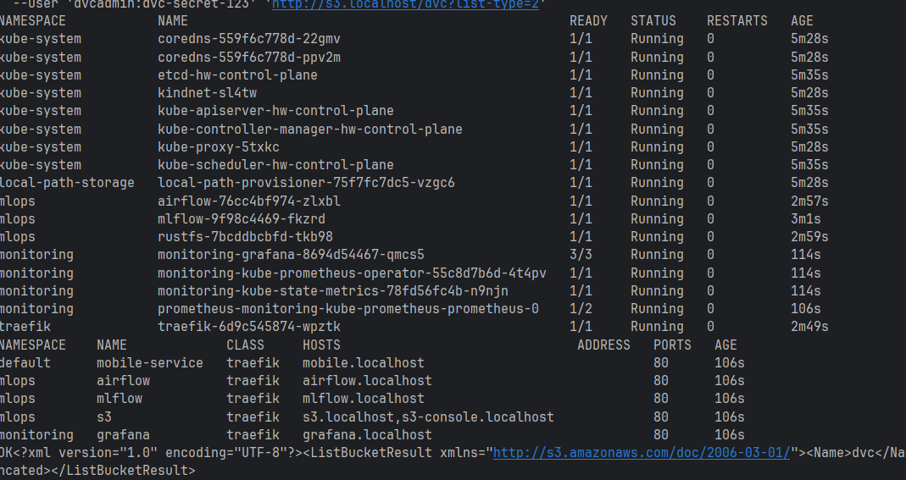
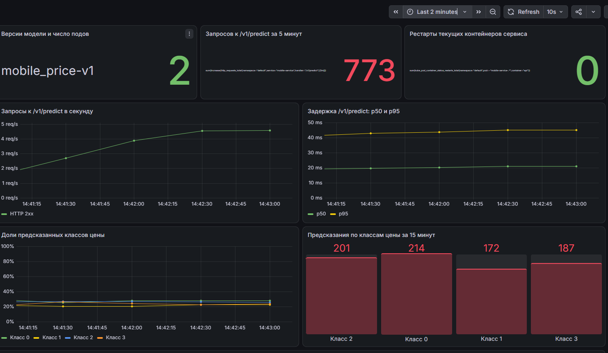
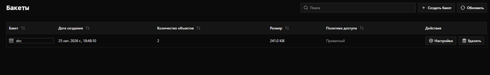
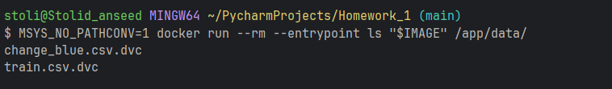

# Базовая часть
## Платформа одной командой:
1. Реализовал QuickStart для моего репозитория. На полный прогон ушло около 14 минут(Самым долгим, как и ожидаемо, оказалсь up.sh примерно заняло минут 8)
 
Все pods running

##  Метрики и дашборд
1. Скрин Dashboard в графане: 

## DVC и S3 кластер
1. Скрин Бакета: 
2. Файл в репозитории .dvc
3. Вывод команды `docker run --rm --entrypoint ls "$IMAGE" /app/data/` 