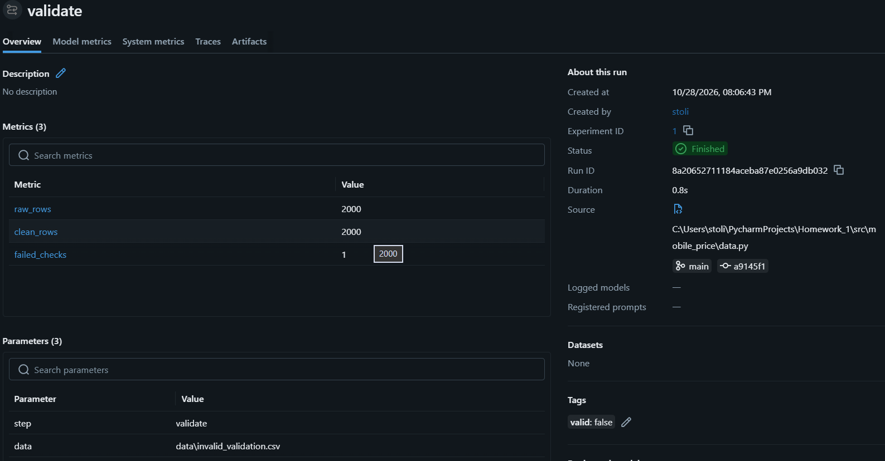
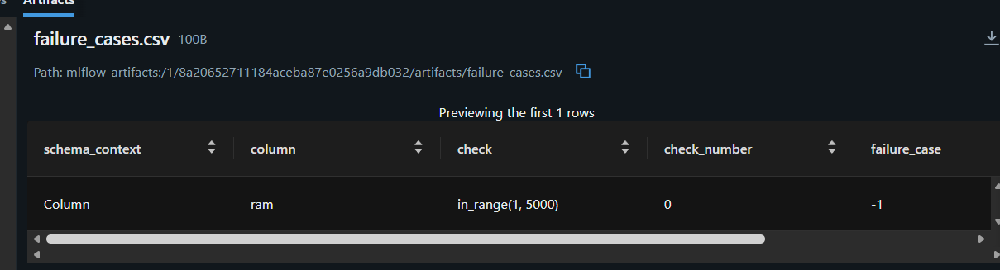
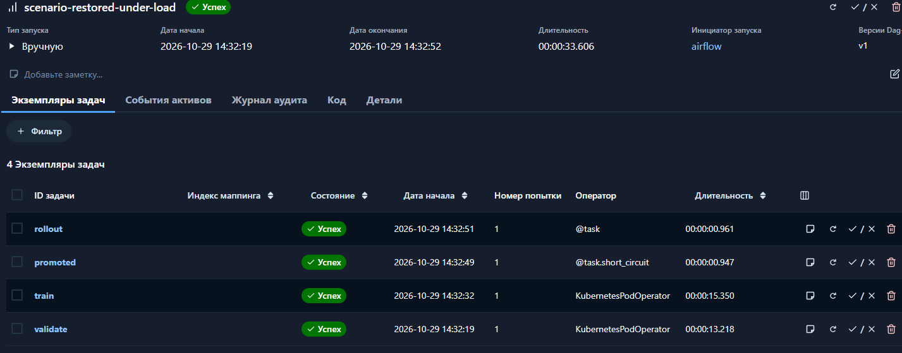
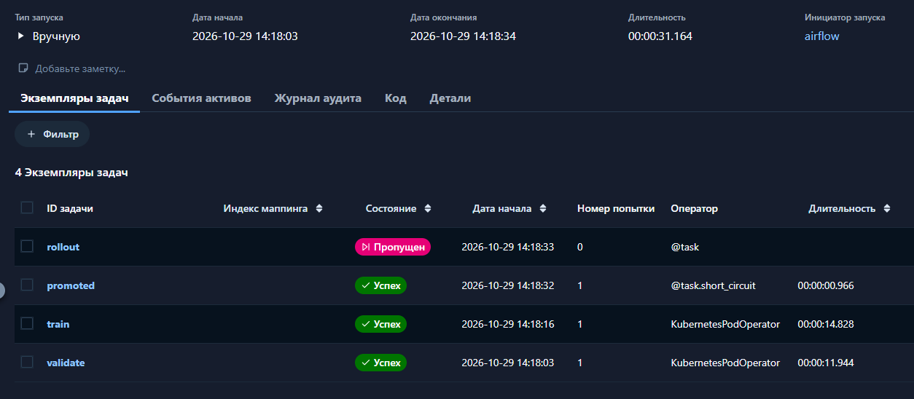
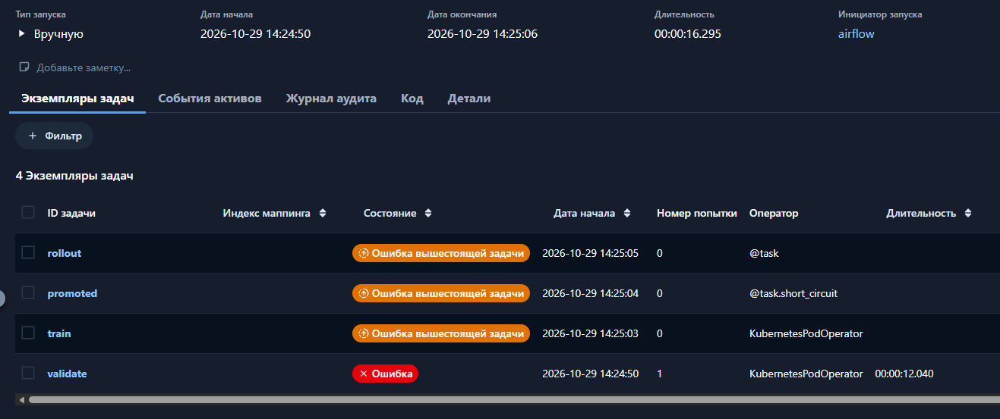
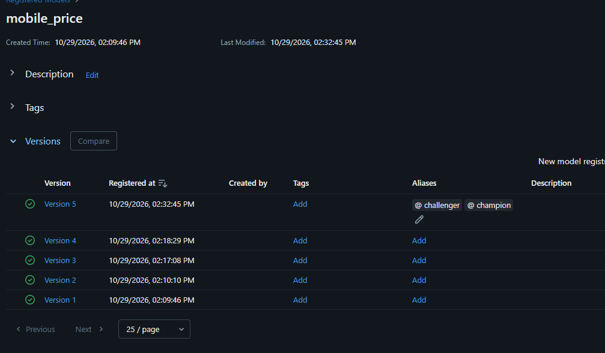
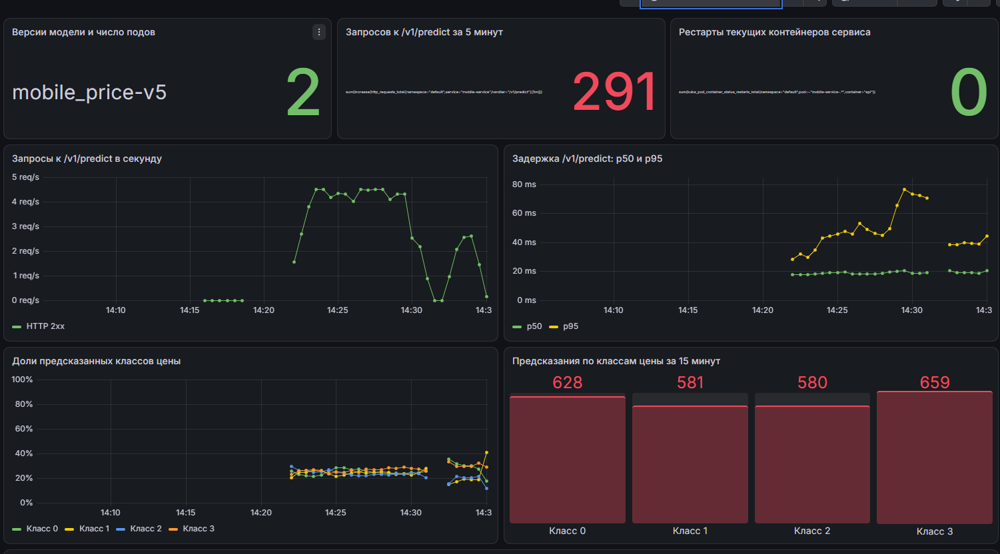

# Базовая часть
## Платформа одной командой:
1. Реализовал QuickStart для моего репозитория. На полный прогон ушло около 14 минут(Самым долгим, как и ожидаемо, оказалсь up.sh примерно заняло минут 8)
 
Все pods running

##  Метрики и дашборд
1. Скрин Dashboard в графане: 

## DVC и S3 кластер
1. Скрин Бакета: 
2. Файл в репозитории .dvc
3. Вывод команды `docker run --rm --entrypoint ls "$IMAGE" /app/data/` 

### Проверка данных
1. [Зелённый прогон](https://github.com/Stolide-anseed/Homework/actions/runs/40731080681/job/122967902906)
2.  Прогон validate в MLflow с valid=false 
3. failure_cases.csv 

### Конвейер переобучения в Airflow
1. Новая версия лучше 
2. Не прошла гейт 
3. плохие данные 
4. MLFLOW(version 5, это как раз первый пункт) 
5. Grafana 

### CI CD - целиком
1. [зеленый прогон, где виден build](https://github.com/Stolide-anseed/Homework/actions/runs/40865347108)

### Q/A:

| id | Q                                                                                                                                                                             | A                                                                                                                                                                                                                                                                                                                                                                                                                                                                                                                                                                                                                                                                                                                         |
|----|-------------------------------------------------------------------------------------------------------------------------------------------------------------------------------|---------------------------------------------------------------------------------------------------------------------------------------------------------------------------------------------------------------------------------------------------------------------------------------------------------------------------------------------------------------------------------------------------------------------------------------------------------------------------------------------------------------------------------------------------------------------------------------------------------------------------------------------------------------------------------------------------------------------------|
| 1  | У вас в реестре версия N модели. По шагам: как восстановить ровно тот код и те данные, на которых она обучена? Какие поля прогона MLflow и какие файлы в git для этого нужны? | В MlFlow можно посмотреть параметры запусков и оттуда взять: data_md5, параметры(C,seed), также артифакты(metadata.json), потом найти коммит в котором проводилось обучение модели и сверить data/train.csv.dvc и data_md5 в MLflow -> востановить данные из DVC командой. И уже можно запускать обучение с C, seed и востановленными данными                                                                                                                                                                                                                                                                                                                                                                             |
| 2  | Почему данные не в образе, а указатели в образе? Что сломается, если сделать git push раньше dvc push, и где вы это увидите?                                                  | Данные не в образе, так как занимают много места и часто становятся не актуальными, поэтому на них хранят ссылки. Если сделать git push предже dvc push в прод попадёт указатель на хранилище, которого нет и dvc pull упадёт                                                                                                                                                                                                                                                                                                                                                                                                                                                                                             |
| 3  | Какие проверки вашей схемы бинарные,а какие с порогом? Как выбирали порог и что будет, если он слишком строгий?                                                               | Бинарные проверки отвечают на вопрос, допустимо ли значение. Например, blue должен быть равен 0 или 1, а price_range — одному из классов 0, 1, 2 или 3. Также проверяются типы столбцов.  Проверки с порогами сравнивают значение с границей или диапазоном. Например, ram должен быть от 1 до 5000, в выгрузке должно быть не меньше 1000 строк, а доля каждого класса — не меньше 10%. Порог доли класса выбран по исходным данным: в них каждый класс составляет около 25%. Граница в 10% допускает изменения, но позволяет заметить сильный перекос или исчезновение класса. Если порог слишком строгий, проверка будет отклонять нормальные данные, задача validate завершится с ошибкой и переобучение остановится. |
| 4  | Чем проверка pandera в конвейере отличается от Pydantic‐схемы в сервисе? Зачем нужны обе                                                                                      | Pydantic проверяет данные в отдельном запросе серверу, в то время как Pandera проверяет датасет перед обучением модели                                                                                                                                                                                                                                                                                                                                                                                                                                                                                                                                                                                                    |
| 5  | Почему обучение идёт в отдельном поде из образа сервиса, а не внутри Airflow? Почему выкат новой модели не требует пересборки образа?                                         | Чтобы разделить обязаности: Airflow отвечает за управление задачи и только загружает уже обученную модель из MLflow по алиасу champion, в то время как в поде выполняется обучения со своими ресурсами. Менять код или пересобирать образ не нужно, так как airflow только управляет и обращается только к MLflow                                                                                                                                                                                                                                                                                                                                                                                                         |
| 6  | Какие метрики на вашем дашборде про инфраструктуру, какие про сервис, какие про модель? Почему request_id нельзя класть в метку Prometheus?                                   | количество рестартов контейнеров. Сервис: количество запросов, запросы в секунду по статусам и задержка p50/p95. Модель: её версия и число подов с этой версией, количество и доли предсказанных классов. request_id уникален для каждого запроса: если добавить его в метку, Prometheus будет создавать огромное число временных рядов и расходовать много памяти и места.                                                                                                                                                                                                                                                                                                                                               |
| 7  | Что происходит с подами и с запросами во время выката новой модели? Зачем preStop и что вы видели без него?                                                                   | Kubernetes постепенно запускает новые поды и завершает старые. Новые поды загружают модель, а запросы направляются на готовые поды. preStop с паузой в 5 секунд даёт время убрать завершающийся под из маршрутизации и уменьшает риск ошибок запросов во время выката. Предпологаю, что без этой паузы запрос может попасть в завершающийся под и получить ошибку.                                                                                                                                                                                                                                                                                                                                                        |
| 8  | Какой отказ вашего проекта в проде самый вероятный? Где и через сколько вы его заметите и что сделаете первым?                                                                | На данный момент, в проде есть вероятность, что произойдёт data drift из-за не актуальности данных. Модель в проде будет показывать плохие результаты, хотя в validation всё работало отлично. Заметить это возможно спустя время, когда модель сильно на ошибается и первым, что стоит сделать это переобучить модель на новых данных и сделать новую выборку для проверки модели                                                                                                                                                                                                                                                                                                                                        |

### Журнал ошибок:

| id | Problem                                                           | Solve                                                              |
|----|-------------------------------------------------------------------|--------------------------------------------------------------------|
| 1  | Генератор трафика сначала не получал ответы от локального сервиса | Проблема была решена выключением ВПН и всё заработало              |
| 2  | PostgreSQL не запускался: ImagePullBackOff                        | Kubernetes повторил скачивание, после чего база перешла в Running  |
| 3  |                                                                   |                                                                    |
| 4  |                                                                   |                                                                    |
